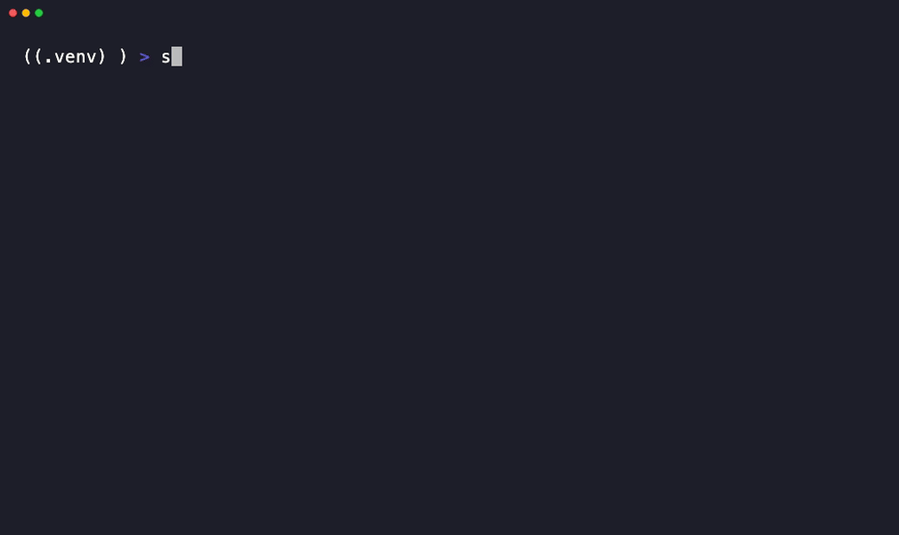

# Sentinela

Revisor de segurança para diffs de código, baseado em regras e em análise de árvore sintática de Python, JavaScript e TypeScript (sem IA, sem rede). Lê um diff, aponta vulnerabilidades nas **linhas adicionadas** e diz o arquivo, a linha, o CWE e como corrigir. Roda no terminal e como GitHub Action em pull requests.

> Projeto de estudo, em evolução. Os números abaixo são medidos, não estimados, e a seção [Limitações](#limitações) diz com franqueza o que ele **não** pega.

## Como é a saída



```
$ git diff main | sentinela revisar -

 ALTA  segredo no código  config.py:2 · CWE-798
  Um valor que parece segredo (chave, token ou senha) está escrito direto no
  código.
  Correção: Leia o valor de uma variável de ambiente ou de um gerenciador de
  segredos e revogue a chave exposta.

 MEDIA  XSS  web/views.py:22 · CWE-79
  HTML é montado ou inserido com valor variável sem escapar, abrindo espaço para
  script injetado.
  Correção: Escape a saída (ou use textContent / template com autoescape) em vez
  de concatenar HTML.

2 achado(s): 1 alta, 1 media.
```

No terminal a severidade vem colorida. Em pull requests, o mesmo relatório vira um comentário em markdown.

## O que ele detecta

Duas camadas, cada achado com CWE, severidade, explicação e correção em português:

1. **Regras por linha** (18 regras, qualquer linguagem): olham o texto de cada linha adicionada.
2. **Análise por AST** (Python, JavaScript e TypeScript): leem o arquivo inteiro pela árvore sintática (`ast` para Python, `tree-sitter` para JS/TS/TSX). Conseguem ligar a *origem* de um dado (`request.args`, `req.query`, `request.json()`, argumentos de server actions do Next.js, parâmetros de rota) ao seu *uso* (`open`, `fs.readFile`, `requests.get`, `fetch`, `query`), mesmo em linhas diferentes, ver SQL montado em várias linhas e olhar a rota ou a função inteira.

| Categoria | CWE | Severidade | Camada |
|---|---|---|---|
| Injeção de comando | CWE-78 | crítica | linha + AST de JS (`exec`/`execSync` com dado externo) |
| Desserialização insegura | CWE-502 | crítica | linha + AST de Python (`read_pickle`, `joblib.load`... com dado externo) |
| Segredo no código (formatos conhecidos) | CWE-798 | crítica | linha |
| SQL injection | CWE-89 | alta | linha + AST (em várias linhas, só se chega a um `execute`/`query`) |
| Path traversal | CWE-22 | alta | AST em Python/JS/TS, linha nas demais linguagens |
| SSRF | CWE-918 | alta | AST em Python/JS/TS, linha nas demais linguagens |
| Trava de SSRF frágil (`host.startsWith('127.')`, regex de prefixos privados): bloqueia endereços internos comparando o começo do texto | CWE-918 | média | linha |
| Segredo no código (atribuição, senha de 6+ caracteres com número ou símbolo, URL com senha) | CWE-798 | alta | linha |
| XSS (`dangerouslySetInnerHTML`, `.html()` do jQuery, HTML na resposta do Express) | CWE-79 | média | linha + AST de JS |
| Filtro em texto do Supabase/PostgREST (`.or()`) com dado do usuário | CWE-89 | média | AST de JS |
| Criptografia fraca (MD5/SHA-1, modo ECB, DES, `random`/`Math.random()` gerando token ou senha) | CWE-327, CWE-338 | média | linha (a de `random` olha 4 linhas) |
| Verificação TLS desativada | CWE-295 | média | linha |
| Exposição de rede (bind em `0.0.0.0`, não só localhost) | CWE-1327 | média | linha |
| Falta de autorização (rota PUT/DELETE/PATCH, route handler e server action sem autenticação visível) | CWE-862 | média | AST |

A AST só trata como "dado externo" o `request`/`req` de arquivos de aplicação web (que importam um framework ou declaram rotas), os parâmetros de rotas e os argumentos das funções exportadas de um arquivo `'use server'` do Next.js (que vêm do navegador). `input()` de um script de terminal não conta, e o `request` de uma biblioteca HTTP também não. Reconhece como limpeza `secure_filename`, `basename`, `Number()`, `encodeURIComponent`, `escapeHtml` e validações do tipo `if (!LISTA.includes(x)) return`, além de host fixo no começo de uma URL.

## Uso no terminal

**Requisito: Python 3.10 ou mais novo** (confira com `python3 --version`; o Python que vem de fábrica no macOS é o 3.9 e não serve, instale um mais novo, por exemplo com `brew install python@3.12`). Sem chave de API e sem rede.

```bash
pip install git+https://github.com/Kako1995/sentinela   # só para usar
# ou, clonando o repositório para mexer no código:
pip install -e ".[dev]"

sentinela revisar mudancas.diff
git diff main | sentinela revisar -
git diff main | sentinela revisar - --formato markdown
git diff main | sentinela revisar - --raiz .      # ativa a análise por AST nos .py/.js/.ts do diff
```

| Opção | O que faz |
|---|---|
| `--formato terminal` (padrão) | Relatório colorido por severidade |
| `--formato markdown` | Texto pronto para comentário de PR |
| `--formato json` | Só JSON, para usar em pipe |
| `--formato sarif` | [SARIF](https://sarifweb.azurewebsites.net/) 2.1.0, para o GitHub Code Scanning mostrar os achados na aba **Security** do repositório, não só no comentário do PR. Ignora `--nota` (SARIF é lido por ferramenta, não por gente) |
| `--raiz PASTA` | Lê os `.py`, `.js`, `.ts` e `.tsx` do diff por inteiro, a partir dessa pasta, e ativa a análise por AST. A Action já usa. Só lê arquivos dentro da pasta, sem seguir links simbólicos, e só se baterem com o diff |
| `--nota` | Acrescenta uma nota de 0 a 10 ao relatório (fórmula e aviso de limitação juntos — não é uma nota de segurança, ver abaixo) |

### Analisar um projeto inteiro

Para um software que já existe, em vez de um diff:

```bash
sentinela varrer caminho/do/projeto
sentinela varrer . -x tests -x docs -f markdown   # -x ignora caminhos (pode repetir)
sentinela varrer . --incluir-md                    # analisa também os .md/.mdx
```

Ele lê todos os arquivos de texto (`.py`, `.js`, `.ts` e `.tsx` também passam pela análise por AST), pulando dependências e builds (`node_modules`, `.venv`, `vendor`, `.next`, `_next`...), caches, arquivos minificados (`*.min.js`), SVG, binários, links simbólicos e arquivos com mais de 1 MB. **Markdown (`.md`/`.mdx`) também fica de fora** por padrão: README e docs têm HTML e código de exemplo de propósito e geravam alertas que não são do código (use `--incluir-md` para analisar mesmo assim). **Ele sempre diz o que pulou e por quê** (na saída de erro, então `-f json` continua sendo só o relatório): por motivo, com os nomes dos primeiros arquivos, e as linhas longas demais (acima de 2000 caracteres) com o arquivo em que estão. Assim, "nenhum alerta" nunca esconde um arquivo que nem foi lido. Os mesmos formatos e códigos de saída do `revisar` valem aqui. Em projeto inteiro os falsos positivos se acumulam, então trate o resultado como uma **lista para conferir**, não como veredito. Só analise código seu ou que você tem permissão de analisar.

**Código de saída:** `1` se houver achado de severidade **alta ou crítica**, `0` caso contrário, `2` se o arquivo não existir. É isso que faz o CI falhar.

### A nota (`--nota`)

Uma régua rápida de 0 a 10, só se você pedir com `--nota` (em `revisar` ou `varrer`). A fórmula é simples de propósito, pra caber numa frase: começa em 10; cada achado crítico tira 3 pontos, alta tira 2, média tira 1, baixa tira 0,5; nunca passa de 0 nem de 10.

**Não é uma nota de segurança.** Uma nota alta quer dizer só que as regras e a análise por AST não acharam muita coisa nas linhas analisadas — não que o código é seguro. Por isso ela sempre vem junto com esse aviso, em qualquer formato de saída.

### Configurar (`.sentinela.toml`)

Arquivo opcional, na raiz do projeto (a pasta passada em `varrer` ou em `--raiz`):

```toml
[regras]
desativar = ["segredo-url-com-senha", "tls-sem-verificacao"]

[varrer]
ignorar = ["migrations/", "*.generated.ts"]
```

Sem o arquivo, ou com algum problema nele (sintaxe inválida, campo no formato errado), o Sentinela roda do jeito de sempre — nada fica desativado — e avisa o motivo no terminal. O próprio arquivo `.sentinela.toml` não entra na varredura.

Pra silenciar só **uma linha** (em vez da regra inteira no projeto), um comentário nela mesma, igual `# noqa` ou `// eslint-disable-line`:

```python
h = hashlib.md5(dados)  # sentinela: ignore (usado só como chave de cache, não senha)
```

## Instalar a Action em outro repositório

Crie `.github/workflows/sentinela.yml` no repositório que você quer proteger:

```yaml
name: Sentinela
on:
  pull_request:

permissions:
  contents: read
  pull-requests: write  # para comentar o relatório no PR

jobs:
  revisar:
    runs-on: ubuntu-latest
    steps:
      - uses: actions/checkout@v4
        with:
          fetch-depth: 0  # o Sentinela precisa do commit base para calcular o diff

      - uses: Kako1995/sentinela@main
        with:
          excluir: "tests docs"  # opcional: caminhos a ignorar, separados por espaço
```

Pronto. Em cada pull request o Sentinela:

1. calcula o diff entre a base e o PR;
2. posta (e depois **atualiza**, sem duplicar) um comentário com o relatório;
3. falha o check se achar algo de severidade alta ou crítica.

Não precisa de nenhuma chave de API nem de `secrets`: ele usa só o `GITHUB_TOKEN` que o próprio GitHub dá a cada execução.

**Permissões:** `contents: read` deixa o job ler o código. `pull-requests: write` é o que permite comentar no PR. Nada além disso.

**Pontos de atenção**
- O `fetch-depth: 0` é obrigatório. Com o checkout raso padrão o commit base não existe e o Sentinela falha de propósito, em vez de passar sem revisar.
- PRs vindos de **forks** recebem um token somente leitura: o comentário não é postado, mas o relatório aparece no resumo do job e o check continua funcionando.
- Para outras pessoas usarem `Kako1995/sentinela@main`, o repositório precisa ser **público**.
- Fixe uma versão (`@v1`, quando houver) em vez de `@main` se quiser estabilidade.

**Opcional: aparecer na aba Security.** A Action acima só comenta no PR. Para também mandar os achados pro GitHub Code Scanning (pede a permissão extra `security-events: write`, por isso fica fora do padrão):

```yaml
      - run: pip install git+https://github.com/Kako1995/sentinela
      - run: git diff ${{ github.event.pull_request.base.sha }} | sentinela revisar - -f sarif > sentinela.sarif
      - uses: github/codeql-action/upload-sarif@v3
        with:
          sarif_file: sentinela.sarif
```

## Como sei que funciona: os evals

Rodar o scanner em casos de código rotulados à mão (vulnerável ou seguro) e medir:

- **Precisão:** dos alertas que ele deu, quantos eram reais. Baixa precisão = falso positivo, e falso positivo faz as pessoas ignorarem a ferramenta.
- **Recall:** das vulnerabilidades que existem, quantas ele achou.

Quatro versões do scanner: `v1` (regras por linha), `v2` (exceções gerais contra falsos positivos), `v3` (análise por AST de Python) e `v4` (análise por AST de JavaScript/TypeScript). Nos mesmos 125 casos, `v3` → `v4`:

| Conjunto | Casos | Precisão | Recall |
|---|---|---|---|
| Python e gerais (iniciais, difíceis, validação, AST) | 92 | 98% → 98% | 92% → 92% |
| JavaScript/TypeScript (Express, Next.js, Supabase) | 33 | 20% → 100% | 7% → 100% |
| **Todos** | **125** | **90% → 98%** | **73% → 94%** |

Casos escritos só depois (medidos só na `v4`): um segundo conjunto de **17 casos de JS/TS** (precisão e recall de 88% na primeira medição, 100% depois de duas correções gerais) e 6 casos de regressão. Somando os **148 casos: precisão 99%, recall 95%** (1 falso positivo e 4 falsos negativos).

**Depois da v4, uma calibração contra código real** (ver Evidência independente 4, abaixo) achou falso positivo em 4 regras e um padrão novo (bind em `0.0.0.0`) sem regra nenhuma. Escrevendo 21 casos genéricos a partir desses padrões (nunca copiando código de ninguém) **antes** de mexer em qualquer regra: precisão caiu pra 92% só com os casos novos, confirmando os falsos positivos. Depois de 4 correções de regra, 1 regra nova e a análise entre funções no mesmo arquivo (Python): **169 casos, precisão 99%, recall 95%** de novo — mesmo nível dos 148, mas numa base mais honesta, com padrões que eu não escolhi pensando nas minhas próprias regras.

**Depois disso, a cobertura da regra de criptografia fraca.** Ela só tinha casos *seguros* (md5 de cache, sha1 de checksum) e nenhum vulnerável, então nunca tinha sido medida de verdade. Escrevi 12 casos (6 vulneráveis, 6 seguros parecidos) **antes** de mexer em qualquer coisa: os 6 seguros passaram, mas **só 2 das 6 vulneráveis foram pegas**. A regra só olhava `hashlib.md5/sha1` e `createHash('md5'/'sha1')`; não pegava AES em modo ECB, DES, nem `random`/`Math.random()` gerando token. Com isso: 181 casos, precisão 99%, **recall 91%**.

Antes de consertar, escrevi mais 12 casos que generalizam o problema (outras bibliotecas, `getrandbits`, `random.choices` para senha temporária) e, principalmente, seguros "armadilha" pra pegar falso positivo: `random.choice` de fichas de jogo com a palavra "token" no nome, `Math.random().toString(36)` como `key` de lista do React, `random.SystemRandom()` (que é seguro), nome de arquivo aleatório. Medido antes do conserto: **193 casos, precisão 99%, recall 85%**. Depois de 3 regras novas (modo ECB, DES, `random` gerando segredo): **193 casos, precisão 99%, recall 96%**. Os 10 casos que mudaram foram todos de erro para acerto; nenhum acerto anterior se perdeu, nenhum falso positivo novo, e os 169 casos de antes ficaram idênticos. Em 1383 arquivos de bibliotecas Python reais as regras novas não geraram nenhum alerta (os mesmos 50 de antes, todos de outras regras). Custo: a varredura ficou cerca de 10% mais lenta.

A regra de `random` é a mais frágil: ela só dispara se **uma palavra de segredo** (`token`, `senha`, `session`, `otp`...) e **uma forma típica de gerar segredo** (sortear caracteres de um alfabeto, `getrandbits`, `Math.random().toString(36)`) aparecem a até 4 linhas de distância. Isso evita falso positivo, mas deixa passar variações (veja Limitações).

**Depois, três falsos positivos que sobraram da calibração em código real** (`token: 'vermelho'` de uma ficha de jogo, `innerHTML` recebendo só número formatado, `__html: ICONES[nome]` de um mapa fixo). Escrevi 14 casos **antes** de mexer nas regras: 7 seguros (que reproduziam o problema) e 7 "controles", parecidos mas vulneráveis, que precisam continuar alertando (`access_token` em minúsculas, `password = "senhaforte"`, número **e** nome de usuário no mesmo template, `ICONES[nome] + usuario.bio`). Medido antes: **207 casos, precisão 92,5%**, com os 7 seguros virando falso positivo. Depois das três correções: **207 casos, precisão 99%, recall 96%**. Os 7 seguros viraram acerto, os 7 controles continuam alertando, nenhum acerto antigo se perdeu e os 193 casos de antes ficaram idênticos.

Rodando de novo nas cópias locais dos 7 repositórios reais da evidência 4: **5 alertas sumiram e nenhum apareceu**. Li os 5, e todos eram falsos positivos (4 fichas de jogo, 1 calculadora com `toFixed`); nenhum achado real foi escondido. Em 1685 arquivos de bibliotecas Python reais: os mesmos 50 alertas. (Essas bibliotecas não têm JavaScript, então só os repositórios reais exercitam duas das três correções.)

Um ponto em que **não** segui a sugestão de quem propôs essa lista: ela pedia para isentar também `toLocaleString()`. Eu não isentei, porque em JavaScript uma *string* também tem `toLocaleString()` e devolve a própria string, sem limpar nada. Só isento o que existe apenas em número (`toFixed`, `Intl.NumberFormat`, `Math.*`) e `Number(x).toLocaleString()`. Há um caso de controle para isso.

**Depois, o recall de senha curta** (`password = "hunter2"` passava em silêncio, porque a regra exigia 8 caracteres). Escrevi 15 casos **antes** de mexer: 5 senhas curtas vulneráveis e 10 seguros "armadilha" (vazia, 3 caracteres, rótulo de tela, máscara `••••••`, nome de variável de ambiente...). Medido antes: **222 casos, precisão 98%, recall 91,6%** (as 5 senhas curtas não eram pegas, e o `PASSWORD_ENV = "DB_PASSWORD"` já era um falso positivo). Depois: **222 casos, precisão 99%, recall 96%**. As 5 senhas viraram acerto, o nome de variável de ambiente deixou de ser falso positivo, nenhum acerto antigo se perdeu e os 207 casos de antes ficaram idênticos.

Este item era o oposto dos anteriores (aumentar detecção em vez de cortar alarme falso), então o risco era criar falso positivo, e **medi isso em código real antes de implementar**. Funcionou, e me salvou de um erro: a primeira versão (aceitar 6 caracteres em qualquer valor) gerou um alerta novo num mapa de rótulos de botão (`'nova-senha': 'Salvar'`). A correção foi exigir **número ou símbolo** na faixa de 6 e 7 caracteres. Mesmo assim, a primeira expressão que escrevi para "símbolo" estava errada: a classe de caracteres incluía as aspas, e a aspa que fecha a string contava como símbolo. Foi o experimento em código real que mostrou isso, e virou um caso de eval e um teste de regressão. Resultado final nos 7 repositórios reais e em 1685 arquivos de bibliotecas: **1527 alertas antes, 1527 depois, 0 sumiram e 0 apareceram**. Ou seja, **a regra não cria falso positivo ali, mas também não achou nenhuma senha curta real**: o ganho de detecção só está demonstrado nos casos sintéticos, que são meus.

**Depois, a trava de SSRF por prefixo de texto** (`host.startsWith('127.')`, `/^(localhost|127\.|10\.|192\.168\.)/.test(hostname)`): uma proteção que parece proteger e deixa passar `172.16.0.1`, `0.0.0.0`, `[::1]` e `100.64.x.x`. A regra que já existia detecta o *pedido* feito com URL do usuário; esta detecta a *trava frágil* que o programador escreveu. Escrevi 17 casos **antes** de implementar: 8 travas frágeis (Python e JS/TS, regex, lista de prefixos, `startsWith`, `includes`) e 9 seguros "armadilha" (`ipaddress` do jeito certo, `startsWith('10.')` numa **versão do Node**, URL base por ambiente, origens de CORS de desenvolvimento com `localhost` e `127.0.0.1`, lista de hosts permitidos, um IP de métrica). Medido antes: **239 casos, recall 89,6%**, as 8 travas passavam em silêncio. Depois: **240 casos, precisão 99%, recall 96%**; as 8 viraram acerto, os seguros continuam passando, nenhum acerto antigo se perdeu e os 222 casos de antes ficaram idênticos.

**Código real achou um erro meu antes de eu publicar:** a primeira versão tratava `10.5` como o prefixo `10.` de um IP, e disparou 5 vezes em dados de desenho de ícones SVG (`cx="10.5"`). Corrigi exigindo que um prefixo de IP termine em ponto ou continue com mais octetos (`10.` ou `10.0.0.1`, mas não `10.5`), e o caso virou um caso de eval e um teste. Depois da correção, nos 7 repositórios reais e em 1685 arquivos de bibliotecas, a regra apontou **1 lugar, e é um acerto verdadeiro** (uma trava por prefixo que esquece a faixa `172.16-31.x`). É só 1 amostra, então ela mostra que a regra não é barulhenta, e não mede o recall.

Recall por categoria (atual, 240 casos): SQL injection 100%, SSRF 100%, XSS 100%, injeção de comando 100%, exposição de rede 100%, criptografia fraca 100%, falta de autorização 92%, path traversal 94%, segredo no código 93%, desserialização 75%.

**Como ler esses números com cuidado**
- **O ganho é, em parte, ajuste ao teste.** Escrevi a AST conhecendo os casos, e depois corrigi o que o segundo conjunto errou. Por isso as três rodadas seguintes de casos não são independentes entre si. A tentativa de manter alguma honestidade foi escrever cada conjunto *antes* de implementar o que ele mede e guardar as medições de cada versão em `evals/resultados/`.
- **Quase todos os casos foram escritos pelo mesmo autor (eu, com IA) que escreveu as regras.** Casos escritos por outra pessoa, sem olhar as regras, seriam o teste mais forte, e ainda faltam.
- **Evidência independente 3, o projeto TypeScript real da varredura anterior** (Next.js + Supabase) com a análise de JS/TS: 20 alertas na primeira versão, dos quais 15 eram falsos positivos sistemáticos de server actions (helpers `requireAdmin()`, `requireOrg()` não eram reconhecidos como autenticação). Depois de corrigir o padrão `require`/`assert`/`ensure` para 5 alertas: os 2 de segredo de antes e 3 server actions finas que repassam os dados a outra função (a autenticação pode estar lá, e a análise não segue chamadas entre arquivos). Nenhum alerta de path traversal, SSRF, SQL ou comando.
- **Evidência independente 4, sete repositórios reais de terceiros em produção** (acesso de leitura, autorizado), em linguagens variadas (TypeScript/Next.js, Python, Swift, Astro): dos alertas de severidade alta e crítica, **nenhum procedeu** na minha leitura, antes de qualquer correção. O padrão mais comum foi a regra confundir o *nome* de uma variável com o dado em si — por exemplo, uma variável chamada com a palavra "token" guardando o nome de uma chave de armazenamento ou um atributo de jogo, não uma credencial. Também achei um servidor caindo para `0.0.0.0` sem regra nenhuma pra avisar. Isso virou os 21 casos novos (acima): o número mais honesto que o projeto tem, porque não fui eu quem escolheu os padrões pensando nas regras.
- **Evidência independente 1, projeto real de terceiros** (Next.js + Supabase, cerca de 500 arquivos): os alertas caíram de 15 para 2 com a v2, e os 13 que sumiram eram falsos positivos. Os 2 que sobraram são pontos para conferir; não há como medir o recall ali.
- **Evidência independente 2, 1650 arquivos de bibliotecas Python reais** (pydantic, pytest, pip, rich...): a varredura expôs defeitos sistemáticos que nenhum caso meu mostrava (o formato `<Classe ...>` de `__repr__` lido como HTML, `model.eval()` do PyTorch lido como `eval`, `request` de biblioteca lido como dado web). Depois de corrigi-los, os alertas caíram de 128 para 50. Os 50 restantes são, na maioria, usos legítimos de APIs sensíveis para um humano conferir (`eval`, `pickle.loads`, HTML montado por f-string), e **não houve nenhum alerta de AST**, que é o esperado para código que não é de aplicação web.
- Com 92 casos, cada caso vale cerca de 1 ponto percentual: os números mostram a tendência, não um valor exato.
- Duas vezes os evals pegaram um erro meu: a primeira correção de SQL derrubou o recall de SQL injection de 83% para 33% (um `(?i)` fazia `nome` parecer constante), e a primeira versão da AST tinha 3 classes de falso positivo que o conjunto fresco mostrou.

Os casos e o método estão em [`evals/`](evals/README.md), e cada rodada fica salva em `evals/resultados/`.

## Limitações

O que o Sentinela **não** pega, e por quê:

- **Só Python, JavaScript e TypeScript têm análise por AST.** Java, PHP, Go e o resto contam apenas com as regras por linha.
- **A análise por AST é por função, com uma exceção.** Em Python, uma função solta chamada direto (`ajuda(x)`, não `obj.ajuda(x)`) **no mesmo arquivo** já é seguida: se a rota repassa o dado para essa função ajudante, a AST sabe. Isso ainda não vale para JS/TS, nem para chamada **entre arquivos** (`import`) em nenhuma das duas linguagens: se a rota passa o dado para um auxiliar em outro módulo que abre o arquivo, a ligação se perde. Em funções que não são rotas (nem server actions) e não são chamadas por uma, parâmetros não contam como dado externo (um `pd.read_pickle(arquivo_enviado)` num auxiliar isolado passa batido), e uma server action fina que repassa tudo a outra função em outro arquivo gera um aviso de autorização que pode ser falso.
- **Falta de autorização é uma heurística.** Ela avisa (severidade média, que não derruba o CI) quando uma rota PUT/DELETE/PATCH, um route handler do Next.js ou uma server action com nome de verbo que altera dados (`apagar`, `update`, `criar`...) não mostra autenticação, mas autenticação feita num middleware, RLS ou gateway não é vista (só se reconhece pelo nome: `auth`, `session`, `getUser`, `requireX()`, `createClient`...): é um ponto para conferir, não um achado confirmado. Rotas POST não entram, porque costumam ser públicas (login, cadastro). Um IDOR (ler o recurso de outro usuário por id numa rota GET) não é detectado.
- **A regra de `random` para segredo é estreita de propósito.** Não pega código numérico (`random.randint(100000, 999999)` para um código por SMS), nem uma variável chamada `valor` que na verdade guarda um token, nem 3DES (que é fraco, mas é outra decisão). E como a palavra de segredo precisa estar a até 4 linhas do sorteio, um sorteio cuja função só se chama "token" mais longe passa.
- **As três isenções mais novas são heurísticas, e cada uma tem um ponto cego.** (1) `token` de jogo: só vale para um nome que *começa* com `token` e um valor de 8 a 16 letras minúsculas; um token real fraco nesse formato (`token = "abcdefgh"`) passa. `api_token`, `access_token`, `password` e `secret` continuam alertando. (2) `innerHTML` só com número: vale para `toFixed`, `Intl.NumberFormat`, `Math.*` e `Number(x).toLocaleString()`, em fórmulas simples (sem parênteses aninhados nos argumentos); `n.toLocaleString()` com `n` desconhecido ainda alerta, porque pode ser uma string. (3) `__html: ICONES[nome]`: vale pelo nome em MAIÚSCULAS, então um mapa em maiúsculas que guardasse dado do usuário esconderia o alerta.
- **Senha curta só de letras passa.** `password = "letmein"` (6 ou 7 letras e nada mais) não alerta, porque é indistinguível de um rótulo de tela (`'Salvar'`, `'Entrar'`); alerta com número ou símbolo (`hunter2`, `p@ss12`) e, de 8 caracteres para cima, sempre. É uma troca consciente de um pouco de detecção por menos alarme falso. Os nomes de variável de ambiente em maiúsculas (`"DB_PASSWORD"`) também não alertam; com número (`SK_LIVE_1234`) alertam.
- **A regra de trava de SSRF por prefixo é uma heurística de texto, com falso positivo e falso negativo conhecidos.** Ela só olha uma linha: uma checagem escrita de outro jeito (comparando o IP depois de converter, ou em várias linhas) não é vista. `ip.startsWith('10.')` com um receptor chamado `ip` **não** alerta de propósito (é comum para marcar tráfego interno em métrica), então a regra perde esse caso. E ela pode alertar numa checagem de rede interna que não protege nenhuma requisição de saída (por exemplo, decidir o que mostrar numa tela); por isso a severidade é média. O que ela **não** faz é provar que a trava é contornável nem que o pedido existe: só diz que o jeito de proteger é frágil.
- **Regras por linha só veem uma linha** (fora a regra do `dangerouslySetInnerHTML`, que olha até 60, e a de `random` para segredo, que olha 4). Em JavaScript e nas demais linguagens, um valor que vem da requisição numa linha e é usado na seguinte perde a ligação.
- **Sem tipos.** Um valor validado por `zod` continua contando como externo; `String(x)` e outras conversões não limpam nada.
- **Nomes e APIs que a regra não conhece.** Uma chave com o nome `chavePagamento` não é vista como segredo (a palavra "chave" também é "chave primária"), e o `startswith` mal feito para limitar uma pasta não é reconhecido como proteção quebrada.
- **Validação que a regra não entende** (falso positivo). Concatenar uma coluna já validada contra uma lista de permitidas continua disparando alerta em SQL, mesmo sendo seguro (a AST entende a validação por lista para caminhos e URLs, não para essa regra por linha). Comandos fixos com `shell=True`, `usedforsecurity=False`, `innerHTML` com texto fixo e referências a variáveis de ambiente já são tratados.
- **As exceções podem esconder um achado real.** Valores com palavras como `fake`, `exemplo` ou `sua-` são tratados como placeholder, e uma constante em MAIÚSCULAS concatenada ao SQL é tratada como constante do código.
- **A janela de 60 linhas** do `dangerouslySetInnerHTML`: um template literal maior que isso, com `${...}` perto do fim, não é visto.
- **Acertar pelo motivo errado.** Os evals medem se o alerta saiu, não se foi pelo motivo certo.
- Só analisa as **linhas adicionadas** (em modo diff): não vê vulnerabilidades que já estavam no arquivo. Para isso existe o `varrer`.

Em resumo: é uma rede de segurança rápida para padrões conhecidos, não uma auditoria. Não substitui revisão humana nem ferramentas de análise mais completas (como CodeQL ou Semgrep).

## Decisões técnicas

- **Regras e AST em vez de IA.** É determinístico, gratuito, offline e cada alerta é explicável: dá para apontar a regra exata que disparou. As regras por linha funcionam em qualquer linguagem; a AST dá a precisão que o texto de uma linha não dá. Python usa o módulo `ast` da biblioteca padrão. **Para JS/TS foi preciso adicionar uma dependência**: o `tree-sitter` (com as gramáticas de JavaScript e TypeScript), porque a biblioteca padrão não traz parser de JS e escrever um à mão seria frágil. Ele vem em binários prontos (Linux, macOS, Windows) e funciona offline. Sem ele instalado, só as regras por linha e a AST de Python funcionam.
- **A AST substitui as regras de path traversal e SSRF nos arquivos Python/JS/TS que ela consegue ler**, porque sabe de onde vem o dado, e as regras por linha só viam a palavra `request` na mesma linha. Se o arquivo não parseia, as regras por linha voltam a valer.
- **Ler o arquivo do disco com cuidado.** O nome do arquivo vem do diff, que pode ser de um PR malicioso. Por isso o `--raiz` só lê arquivos dentro da pasta indicada, não segue links simbólicos e descarta o arquivo se ele não bater linha a linha com o diff.
- **Limite de tamanho por linha, por segurança, não só desempenho.** Algumas regex (ex.: SQL injection) têm custo que cresce com o quadrado do tamanho da linha quando ela não casa. Uma linha gigante sem quebra de verdade (SVG, bundle minificado) — e o conteúdo do arquivo também pode vir de um diff malicioso — travava a varredura por minutos. Linha acima de 2000 caracteres pula as regras por linha; a AST, que lê o arquivo de outro jeito, não é afetada.
- **"Dado externo" só em contexto web.** `request`/`req` conta se o arquivo importa um framework web ou declara rotas; `input()` de script nunca conta. Foi a lição da varredura de bibliotecas reais. No Next.js, os argumentos das funções exportadas de um arquivo `'use server'` contam como externos, porque vêm do navegador, e os parâmetros dos route handlers (`route.ts`) e das páginas (`page.tsx`) vêm da URL.
- **Revisar o diff, não o repositório.** O desenvolvedor só vê alertas sobre o que acabou de escrever, e o tempo de execução não cresce com o tamanho do projeto.
- **Falhar em vez de aprovar sem revisar.** Se o git não consegue calcular o diff (checkout raso), a Action falha com uma mensagem clara. Um diff vazio por erro viraria "nenhum problema", que é pior que um erro.
- **Código de saída por severidade.** Só alta e crítica quebram o CI. Média e baixa aparecem no relatório sem bloquear, para a ferramenta não virar um obstáculo.
- **Dois níveis de silenciar um alarme falso, não um só.** `# sentinela: ignore` numa linha é exceção pontual, de quem está mexendo naquele código agora; `.sentinela.toml` desativa a regra pro projeto inteiro, decisão de quem mantém o repositório. Sem os dois, alguém de fora usando a ferramenta e batendo num alarme falso não teria opção além de reclamar ou ignorar o relatório inteiro.
- **Evals por caso, com casos difíceis separados.** Medir só em exemplos fáceis daria números bonitos e inúteis, por isso os casos que enganam a regra têm uma tabela própria.
- **Um comentário por PR, atualizado a cada push**, achado por um marcador invisível, em vez de uma pilha de comentários.

## Desenvolvimento

```bash
python -m venv .venv && source .venv/bin/activate
pip install -e ".[dev]"
pytest
python evals/run_evals.py --rotulo minha-rodada   # mede precisão e recall (veja evals/README.md)
```

Estrutura: `src/sentinela/` (`diff.py` lê o diff, `varredura.py` percorre pastas, `regras.py` define as regras por linha, `ast_python.py` e `ast_js.py` fazem a análise por AST, `scanner.py` junta tudo, `report.py` formata a saída, `avaliacao.py` calcula as métricas), `tests/`, `evals/` e `action.yml`.

## Licença

[MIT](LICENSE).
